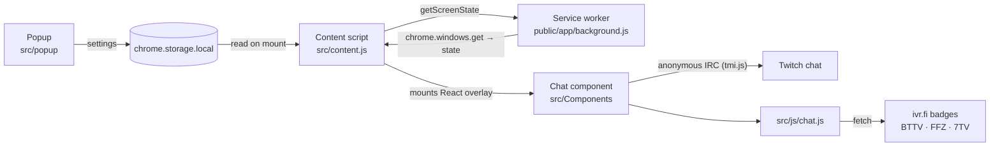

# Floating Twitch Chat

[](https://github.com/xD33m/floating_twitch_chat/actions/workflows/ci.yml)
[](LICENSE)
[](public/manifest.json)

A Manifest V3 Chrome extension that floats Twitch chat over the fullscreen video
player, with Twitch, BTTV, FFZ and 7TV emotes and channel badges.

## Why

Twitch hides chat as soon as the player goes fullscreen, so you have to choose
between a big picture and following chat. This extension puts a draggable,
semi-transparent chat on top of the player instead, so you can have both.

## Features

- **Chat over the fullscreen player.** The overlay appears on channel pages
  (`twitch.tv/<channel>`) while the window is fullscreen and goes away when you
  leave fullscreen or navigate somewhere else.
- **Emotes from four providers.** Twitch emotes (from the IRC tags), plus global
  and channel emotes from BTTV, FFZ and 7TV, including animated 7TV emotes.
- **Badges.** Global and channel badges (subscriber, moderator, etc.).
- **Drag it anywhere** on the player. Messages line up against whichever side of
  the player the chat is closer to.
- **Settings popup:** compact mode, background colour and opacity, chat height
  (as a percentage of the screen height), chat scale (10% to 200%), a switch to
  disable the overlay and a reset button.
- **A close button** on the overlay that disconnects from chat until the overlay
  is mounted again.
- **No Twitch login, and one permission.** Chat is read anonymously over IRC,
  and the manifest only asks for `storage`.

## Install

### From a release

1. Download `floating-twitch-chat-<version>.zip` from the
   [Releases](https://github.com/xD33m/floating_twitch_chat/releases) page.
   Releases are built by the release workflow when a `v*` tag is pushed, and
   every CI run also uploads the same zip as a workflow artifact.
2. Unzip it into a folder.
3. Open `chrome://extensions`, turn on **Developer mode**, click
   **Load unpacked** and pick that folder.

### From source

```bash
pnpm install
pnpm build
```

Then load the `build/` folder with **Load unpacked** as above.

Open a channel, press <kbd>F</kbd> to go fullscreen and the chat appears.

## Development

The project uses [pnpm](https://pnpm.io); `packageManager` in `package.json` pins
the version, so with corepack enabled the right one is picked up. Use Node 22 or
newer (CI runs Node 24).

| Command          | What it does                                                                  |
| ---------------- | ----------------------------------------------------------------------------- |
| `pnpm build`     | Production build into `build/`, then packs `dist/floating-twitch-chat-<version>.zip` |
| `pnpm zip`       | Repacks the existing `build/` into the zip without rebuilding                  |
| `pnpm dev`       | One development build (with source maps)                                      |
| `pnpm watch`     | Rebuilds on change; reload the extension in `chrome://extensions` afterwards  |
| `pnpm test`      | Offline unit tests: emote and badge parsing, matching and URL building         |
| `pnpm test:live` | Live tests against the real Twitch/BTTV/FFZ/7TV/ivr.fi endpoints and Twitch IRC |

The zip has `manifest.json` at its root, which is the layout the Chrome Web
Store expects for an upload.

Tests use the built-in `node:test` runner, with no test framework dependency.
`pnpm test:live` needs network access and a busy Twitch chat; it is the check
that catches an upstream API disappearing, which is what broke emotes and badges
before.

### CI

- [`ci.yml`](.github/workflows/ci.yml) runs on every push and pull request:
  `pnpm install --frozen-lockfile`, the unit tests, the production build, a
  check that the result is a Manifest V3 build with `manifest.json` at the zip
  root, and uploads the zip as an artifact.
- [`release.yml`](.github/workflows/release.yml) runs on `v*` tags. It refuses to
  release when the tag does not match the version in `manifest.json`, then
  attaches the zip to a GitHub release.
- [`live.yml`](.github/workflows/live.yml) runs the live suites weekly and on
  demand. It is kept out of CI because it depends on third party services and
  can fail for reasons unrelated to a change.
- Dependabot keeps the GitHub Actions and npm dependencies up to date.

## Architecture



| Path                       | What it is                                                                       |
| -------------------------- | -------------------------------------------------------------------------------- |
| `src/content.js`           | Content script: decides when to mount and unmount the overlay                    |
| `src/Components/`          | The React overlay: chat connection, message list, dragging                       |
| `src/js/chat.js`           | Emote (Twitch, BTTV, FFZ, 7TV) and badge fetching, matching and URL building     |
| `src/popup/`               | The settings popup: script and styles                                            |
| `public/manifest.json`     | Manifest V3                                                                      |
| `public/app/background.js` | Service worker; only reports the window's fullscreen state                       |
| `public/popup.html`        | Popup markup; loads the bundled `static/js/popup.js` and `static/css/popup.css`  |
| `public/assets/`           | Extension icons. `icon.svg` is the source the PNGs are rendered from; it is not shipped |
| `scripts/zip.mjs`          | Packs `build/` into the store-ready zip                                          |
| `store/`                   | Chrome Web Store listing copy and promo artwork; not part of the extension       |
| `tests/`                   | `*.test.js` run offline, `*.live.js` hit the real services                       |

How the pieces fit:

- **Content script.** Twitch is a single page app that throws the player away and
  rebuilds it on navigation, so the content script polls every 500 ms for the
  player's `.video-player__overlay` element and re-attaches its root there. It
  only does real work (asking the service worker, mounting React) when the path
  or the attachment changed, or on `resize` / `fullscreenchange`. The overlay is
  only mounted on paths that are actually a channel; a list of reserved top level
  paths (`directory`, `settings`, `videos`, ...) is excluded.
- **Service worker.** `chrome.windows` is not available to content scripts, so the
  worker answers a single `getScreenState` message with the window state. It
  keeps no state, because an MV3 worker can be torn down between messages. If it
  is unreachable (for example after the extension was reloaded), the content
  script treats that as "not fullscreen" instead of throwing.
- **Overlay.** A React class component connects to the channel with tmi.js and no
  identity (read-only), turns each message into text and emote parts, and keeps
  the last 100 lines so a long stream does not grow the DOM forever. Dragging is
  done with framer-motion, constrained to the player.
- **Data layer.** The channel id comes from the `room-id` IRC tag. Emote and badge
  lists are fetched once per channel and cached in module-level objects; a failed
  fetch is logged and the affected emotes simply render as text.
- **Build.** A single webpack 5 config with two entry points (`content`, `popup`).
  Everything under `public/` is copied into `build/` verbatim; `src/` is bundled
  into `build/static/`. Nothing in the build reads out of `node_modules` by path,
  so it works the same under pnpm, npm or Yarn PnP. Output is left unminified on
  purpose, which makes Chrome Web Store review easier.

## Notable engineering

### Manifest V3 migration

The extension had stopped working: Chrome is phasing out Manifest V2, and three
upstream APIs it relied on had disappeared. The migration
([#3](https://github.com/xD33m/floating_twitch_chat/pull/3)) covered:

- `background.scripts` became a stateless `service_worker`, `browser_action`
  became `action`, and unused `web_accessible_resources` were dropped.
- Permissions shrank to just `storage`. The old host permissions for FFZ, BTTV and
  the Twitch CDN bought nothing in MV3, where a content script fetch obeys CORS
  regardless and all of these APIs send a permissive
  `Access-Control-Allow-Origin`. Requests are kept free of custom headers so they
  are never preflighted.
- **Channel id:** the Kraken (v5) users lookup now answers 404. The `room-id` IRC
  tag carries the same id, so no Twitch API call (and no client id or token,
  which an extension cannot keep secret) is needed.
- **Badges:** `badges.twitch.tv` no longer resolves. Badges now come from
  `api.ivr.fi/v2/twitch/badges`, a public Helix mirror, normalised back into the
  shape the rest of the code expects.
- **Twitch emotes:** moved from the deprecated v1 emoticon CDN to v2.
- **Build:** the ejected create-react-app webpack 4 toolchain no longer installed
  on current Node (node-sass 4 needs Node 14 or older). It was replaced with one
  webpack 5 config, which cut the dev dependencies from 40 to 7 at the time. Webpack 5.109+
  enables `experiments.typescript` by itself on Node 22.6+, which makes the
  resolver follow a stray `tsconfig.json` published by popmotion and breaks every
  framer-motion import, so the config switches it off explicitly.
- **Fixes found while verifying in a real browser:** the popup died completely
  if `chrome.storage` errored, disconnecting an already closed tmi.js socket
  threw, the injected CSS restyled Twitch's own `<body>`, and the overlay kept
  every message forever.
- FFZ emotes had never rendered: only the first set was read, channel emotes
  were filed as global, and the `name` field was never mapped.

### 7TV emote support

Most large channels now keep their emotes on 7TV, so without it much of chat
rendered as plain text
([b29ffbd](https://github.com/xD33m/floating_twitch_chat/commit/b29ffbd)):

- Global emotes come from `7tv.io/v3/emote-sets/global`; channel emotes come from
  `7tv.io/v3/users/twitch/<room-id>`, which returns the channel's active emote
  set. Images are `cdn.7tv.app` webp files, which also covers animated emotes.
- A channel with no 7TV account answers 404, which is treated as "no emotes", not
  as an error. The same rule applies to BTTV and FFZ.
- When several providers define the same code, 7TV wins, then BTTV, then FFZ,
  the order established chat clients use. A Twitch emote beats all three because
  its exact position comes from the message tags. A channel emote overrides a
  global one with the same code.
- Third party codes are matched as whole words, so `monkaS` does not match inside
  `monkaSSS`.
- The emote lookup was measured at about 34 µs per message with 1,300 third
  party emotes loaded, so the straightforward scan was kept.

These rules are pinned down by the offline tests in `tests/emotes.test.js`, and
`tests/*.live.js` checks that every provider still answers and that the image
URLs the overlay would render return real images.

## Limitations

- **Fullscreen only.** By design the overlay is only shown while the browser
  window is fullscreen; in theatre or normal mode it stays hidden.
- **Read-only.** Chat is read anonymously, so you cannot send messages from the
  overlay.
- **Depends on Twitch's markup.** The overlay is attached to the player's
  `.video-player__overlay` element. If Twitch renames it, the overlay will not
  appear until the selector is updated (this happened once before, in 2022).
- **Channel pages only.** Only `twitch.tv/<channel>` pages get the overlay, not
  VODs or clips.
- **Settings apply on the next mount.** The overlay reads its settings when it
  mounts, so a change in the popup shows up the next time you enter fullscreen.
- **Emote lists are loaded once** per channel per connection. Emotes a channel
  adds mid-stream show up after the overlay reconnects.
- **Chrome only.** The manifest targets Chrome 88+. Other Chromium browsers may
  work but are not tested; Firefox is not targeted.
- **Third party services.** Badges and BTTV/FFZ/7TV emotes depend on those
  services being up. If one fails, its emotes or badges are just missing.

## How this was built

Lucas started the extension in 2021 on top of the
[react-chrome-extension](https://github.com/satendra02/react-chrome-extension)
boilerplate, which is why the early history includes its commits. The 2026 work
(the Manifest V3 migration, 7TV support, the move to pnpm, the new popup and
icon, and this CI setup and README) was done with Claude Code as a pair
programmer; those commits carry a `Co-Authored-By: Claude` trailer. Behaviour
was checked in a real Chrome against live Twitch chat, and the offline and live
test suites were added as part of that work.

## License

[MIT](LICENSE)
